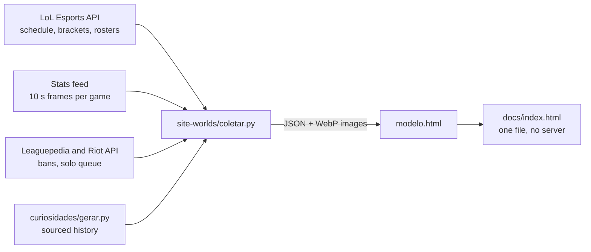

# Worlds 2026 Hub

[🇧🇷 Português](README.md) · **🇺🇸 English**

[](https://github.com/gabriel00lima/worlds-2026-analytics/actions/workflows/ci.yml)


I follow the League of Legends World Championship every year and always wanted one place that brought together, in Portuguese and in Brazilian time, the bracket, the numbers behind each game and a quick way to understand what happened in a match without watching hours of broadcast. So I built it.

The project pulls **Worlds 2026** data straight from the public LoL Esports APIs, processes it in Python and generates a static site with clickable brackets, matchup previews, team and player stats and an **animated, narrated replay** of every game. The site itself is in Brazilian Portuguese.

**[▶ See it live](https://gabriel00lima.github.io/worlds-2026-analytics/)**


## Features

- **Brackets:** double-elimination Play-In, 5-round Swiss Stage and knockouts. Every match opens its own page.
- **Match preview:** countdown, each team's run, lane-by-lane matchups with player photos, head-to-head history and trivia. Each trivia item keeps its source and a confidence level.
- **Narrated replay:** the game is rebuilt on the map from 10-second samples, with kills, towers, dragons, Baron, a gold-difference chart and spoken narration.
- **Players:** KDA, gold, CS and champions for each player in the tournament, plus what they have been playing in solo queue.
- **Tournament leaders:** most kills and the most picked and most banned champions.
- **Predictions:** visitors pick the winner and the score.
- Works well on mobile.

<p>
  
  
</p>

## How it works



**Collection.** `coletar.py` pages through the league schedule, matches teams to rosters and downloads each game's timeline in parallel batches with `ThreadPoolExecutor`. Everything is cached on disk, so a rerun only fetches what is new. Requests retry with growing back-off, since the feed is flaky on match days.

**Processing.** The feed gives the game state every 10 seconds but never says what happened. Events (kill, tower, dragon, Baron) come from diffing two consecutive frames. The game clock skips technical pauses, the time series is downsampled to one point every 30 seconds to keep the page light, and each game's winner is inferred from the final state and checked against the official series score.

**Site.** Plain HTML, CSS and JavaScript, no framework and no build step. Data and images (converted to WebP with Pillow) are embedded in a single `index.html` that opens straight from disk or any static host such as GitHub Pages. The map and charts are SVG and the narration uses the browser's Web Speech API.

**Updates.** During the tournament a scheduled job runs the collector twice a day and publishes the new version.

## Layout

```
site-worlds/     collection (coletar.py, extras.py) and the site template (modelo.html)
curiosidades/    history and trivia for each matchup and team, as JSON
soloq/           solo queue accounts of the 81 players and the scripts that collect them
resumo-diario/   Markdown summary of a day's games
tests/           pytest tests
docs/            published site (GitHub Pages) and README images
```

## Running locally

Requires Python 3.10 or newer.

```bash
git clone https://github.com/gabriel00lima/worlds-2026-analytics.git
cd worlds-2026-analytics
pip install -r requirements.txt

python3 curiosidades/gerar.py              # builds the trivia JSON
python3 site-worlds/coletar.py             # collects data and builds site-worlds/index.html
python3 site-worlds/coletar.py --so-site   # rebuilds the HTML from cache only

python3 resumo-diario/resumo.py 2026-10-18 # summary of one day's games
```

Then open `site-worlds/index.html` in a browser.

No key is required. The LoL Esports API uses a public key, the same one lolesports.com sends from the browser, and it can be overridden with `LOLESPORTS_API_KEY`. To pull solo queue matches, set `RIOT_API_KEY` to a Riot developer key (see `.env.example`).

### Tests

```bash
pip install -r requirements-dev.txt
pytest
```

GitHub Actions runs the tests on Python 3.10 and 3.12 on every push.

## Data sources

| Source | What it provides |
|---|---|
| `esports-api.lolesports.com` | schedule, brackets, teams, rosters and series details |
| `feed.lolesports.com/livestats` | game state every 10 s: gold, kills, towers, dragons, items |
| Leaguepedia (`lol.fandom.com`) | bans, heralds and players' solo queue accounts |
| Riot API | recent solo queue matches |
| Data Dragon and `static.lolesports.com` | champion and item icons, logos and photos |
| Esports news sites | history and trivia, with each source URL |

## Known limitations

- The feed has no coordinates, so player positions on the replay map are approximated from each player's lane.
- Solo queue accounts come from a community-run wiki and may be out of date.

## Next steps

- Live scores, calling the API straight from the browser when the site runs on GitHub Pages.
- Compare team performance with previous Worlds.

## Disclaimer

Personal, non-commercial project. Not endorsed by Riot Games. League of Legends and Riot Games are trademarks of Riot Games, Inc.

Built by **Gabriel Lima** · code under the [MIT](LICENSE) license.
