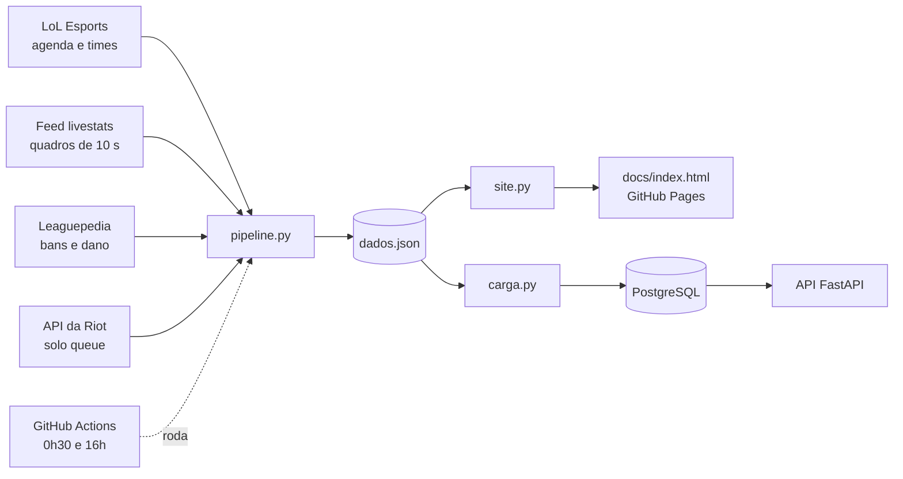
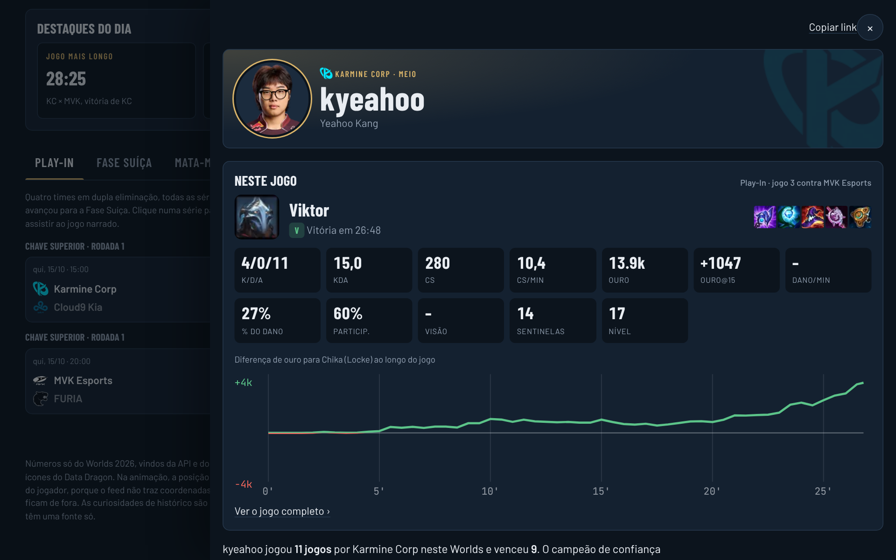

# Central do Worlds 2026

[](https://github.com/gabriel00lima/worlds-2026-analytics/actions/workflows/ci.yml)
[](https://github.com/gabriel00lima/worlds-2026-analytics/actions/workflows/coleta.yml)


Site e API com as chaves, estatísticas e replays do Mundial de League of Legends 2026, em português e no horário de Brasília.

**Site:** https://gabriel00lima.github.io/worlds-2026-analytics/


## Sobre

Comecei esse projeto porque queria acompanhar o Worlds num lugar só: ver a chave, abrir um confronto e entender o que aconteceu no jogo sem precisar rever a transmissão inteira.

A parte em Python busca os dados na API do LoL Esports, processa a linha do tempo de cada partida e gera um site estático com tudo embutido. Os mesmos dados vão para um banco SQL e ficam disponíveis numa API REST.

No site dá para:

- navegar pelo Play-In, pela Fase Suíça e pelo mata-mata, com a chance de classificação de cada time na Suíça;
- abrir um jogo e assistir aos principais lances num mapa animado, com narração em voz neural e a curva de chance de vitória ao longo da partida;
- clicar em qualquer jogador e ver como ele foi naquele jogo, no torneio e na solo queue, com elo, histórico de PDL, campeões com mais maestria e um resumo do dia;
- ver o meta do torneio (campeões mais escolhidos e banidos, com as restrições do Fearless Draft e a média histórica), abrir a página de cada campeão, comparar dois jogadores e conferir os destaques do dia, com uma tabela por posição de dano, ouro e farm por minuto;
- buscar qualquer jogador, time ou campeão (atalho `/`);
- trocar a interface para inglês (os textos gerados e a narração continuam em português);
- deixar palpites, adicionar os jogos na agenda e compartilhar o link direto de um time ou jogador;
- ligar o modo sem spoiler, que esconde placares, vencedores e chances para quem ainda vai ver o jogo gravado, e abrir o VOD oficial no momento de cada lance;
- comparar 2026 com os Mundiais de 2011 a 2025: carreira de cada jogador, campanhas dos times, campeões por edição e recordes.


## Estrutura

```
src/worlds2026/
  fontes/           um cliente para cada fonte: LoL Esports, feed livestats, Leaguepedia, Riot, Data Dragon
  processamento.py  transforma os quadros do feed em lances, série de ouro e estatísticas
  pipeline.py       as etapas da coleta, da agenda até o site pronto
  site.py           junta o template, o CSS, o JS e os dados num único index.html
  api/              API REST com FastAPI e SQLAlchemy, com migrações do Alembic em api/migracoes
  cli.py            linha de comando
web/                o site: index.html, estilo.css e app.js
data/               curiosidades, história dos Mundiais de 2011 a 2025 e contas de solo queue
scripts/            geradores das curiosidades, da carreira dos jogadores e da narração
tests/              testes com pytest, incluindo uma coleta completa com as fontes simuladas
docs/               site publicado no GitHub Pages, com os áudios da narração
```

## Como funciona



O feed da Riot entrega o estado de cada jogo de 10 em 10 segundos, mas não diz o que aconteceu. O `processamento.py` encontra os abates, torres e dragões comparando um quadro com o seguinte e desconta as pausas técnicas do relógio. Essa parte não acessa a rede, o que deixa fácil de testar.

Os clientes em `fontes/` cuidam da parte chata: paginação, novas tentativas quando a API falha e cache em disco, para que rodar de novo só baixe o que é novo. Os quadros de cada jogo são buscados em paralelo. Se houver uma `RIOT_API_KEY` no ambiente, entram também as partidas de solo queue dos jogadores.

O site é HTML, CSS e JavaScript sem framework, com animações em GSAP. O `site.py` embute tudo num único `docs/index.html`, que o GitHub Pages publica.

Uma tarefa agendada no GitHub Actions roda a coleta às 0h30 e às 16h de Brasília, grava a narração dos jogos novos e publica o site atualizado. Os jogos já processados ficam no cache do Actions, então cada execução só baixa o que é novo.

Três partes do site fazem conta de verdade no navegador:

- **Chance de classificação na Suíça.** Uma simulação de Monte Carlo joga 10 mil vezes o resto da fase, respeitando a regra de não repetir confronto entre times da mesma campanha. A chance de cada jogo vem das vitórias de cada time no torneio, puxada para 50% enquanto há poucos jogos.
- **Chance de vitória durante o jogo.** Uma regressão logística é treinada na hora com os quadros de todos os jogos coletados. As variáveis são diferença de ouro (com peso maior no fim do jogo), torres, dragões e barões.
- **Narração.** O roteiro de cada replay é montado a partir dos lances, e o `scripts/gerar_audio.py` grava esse roteiro com voz neural em pt-BR. Os áudios ficam em `docs/audio/`. Quando um jogo ainda não tem áudio gravado, o site usa a voz do navegador.



## API

A API carrega os dados da última coleta num banco e responde em JSON. A documentação interativa fica em `/docs`.

O banco é PostgreSQL no Docker e SQLite quando roda direto na máquina, escolhido pela `DATABASE_URL`. O esquema é versionado com Alembic: a API aplica as migrações que faltam ao subir. Uma mudança nos modelos vira migração com `alembic revision --autogenerate -m "..."`, e um teste falha se algum modelo mudar sem migração.

| Rota | O que devolve |
|---|---|
| `GET /partidas` | séries do torneio, com filtros por fase, estado e time |
| `GET /partidas/{id}` | a série com cada jogo, as estatísticas dos 10 jogadores e os bans |
| `GET /times` e `/times/{sigla}` | campanha, elenco, campeões mais jogados e mais banidos pelo time e contra ele |
| `GET /jogadores/{id}` | desempenho no torneio, campeões no torneio e na solo queue, elo |
| `GET /estatisticas/jogadores` | ranking por abates, KDA ou dano |
| `GET /estatisticas/campeoes` | campeões por presença (escolhas + bans), com vitórias |

## Rodando

```bash
pip install -e ".[dev]"
python -m worlds2026              # coleta os dados e atualiza docs/index.html
python -m worlds2026 --so-site    # só regera o site com o que já está em cache
python -m worlds2026 api          # carrega o banco e sobe a API em http://localhost:8000
pytest --cov
```

Ou com Docker, que sobe a API junto com um PostgreSQL, depois de rodar a coleta uma vez:

```bash
docker compose up
```

O CI roda `ruff`, `mypy` e os testes a cada push. Os testes da API e das migrações rodam também contra um PostgreSQL de verdade.

## Decisões técnicas

- **Site estático com os dados embutidos.** O site não depende de servidor nenhum: abre rápido, funciona no GitHub Pages e continua no ar mesmo se a API da Riot cair. O custo é regerar o arquivo a cada coleta, que a tarefa agendada resolve.
- **Lances deduzidos dos quadros.** O feed não tem eventos, só fotos do estado do jogo. Comparar quadros seguidos dá para reconstruir abates, torres e objetivos, e isso fica numa camada sem rede, testada com quadros montados à mão.
- **Cache em disco antes de tudo.** Um jogo processado não é baixado de novo. Isso deixa a coleta rápida e evita estourar os limites das APIs, principalmente o da Riot.
- **Banco separado do site.** O site lê um JSON pronto. A API usa o mesmo JSON para popular um banco relacional, onde as agregações (KDA, presença de campeões, campanha dos times) viram consultas SQL em vez de laços em Python.
- **Migrações desde a primeira tabela.** Mesmo com um esquema pequeno, o Alembic deixa qualquer mudança reproduzível, e o CI confere que modelos e migrações não divergem.

## Limitações

O feed não manda a posição dos jogadores, então no replay eles aparecem na rota em que jogam, não no ponto exato do mapa. As contas de solo queue vêm da Leaguepedia, que é mantida pela comunidade e às vezes está desatualizada.

---

Projeto pessoal, sem ligação com a Riot Games. Licença MIT.
