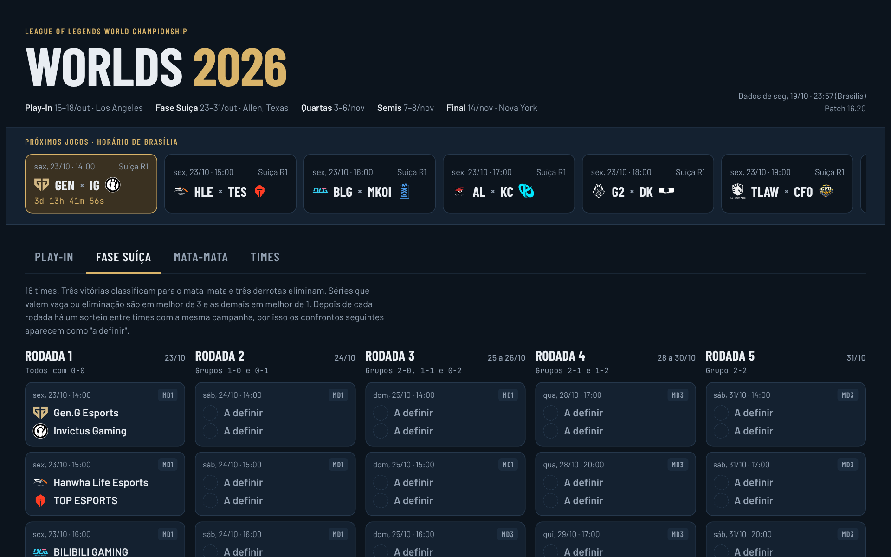
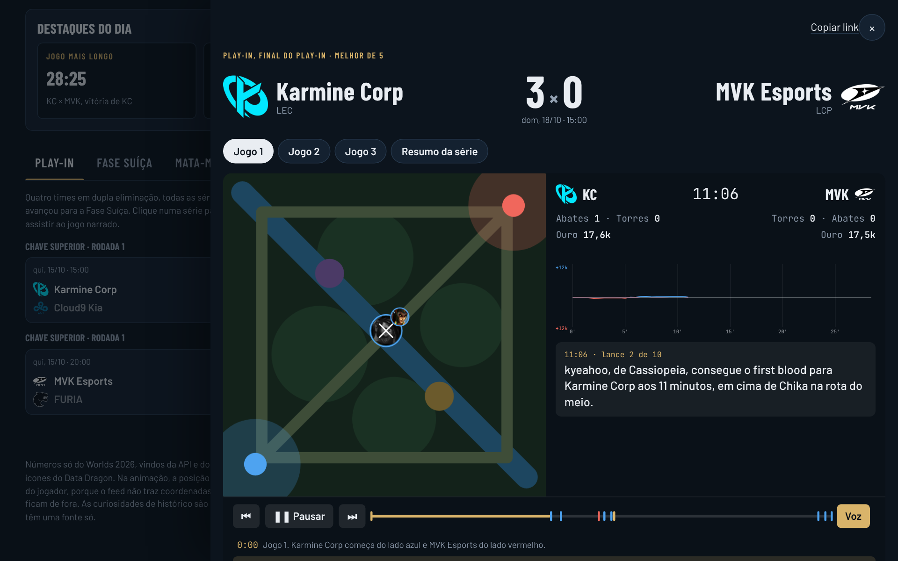
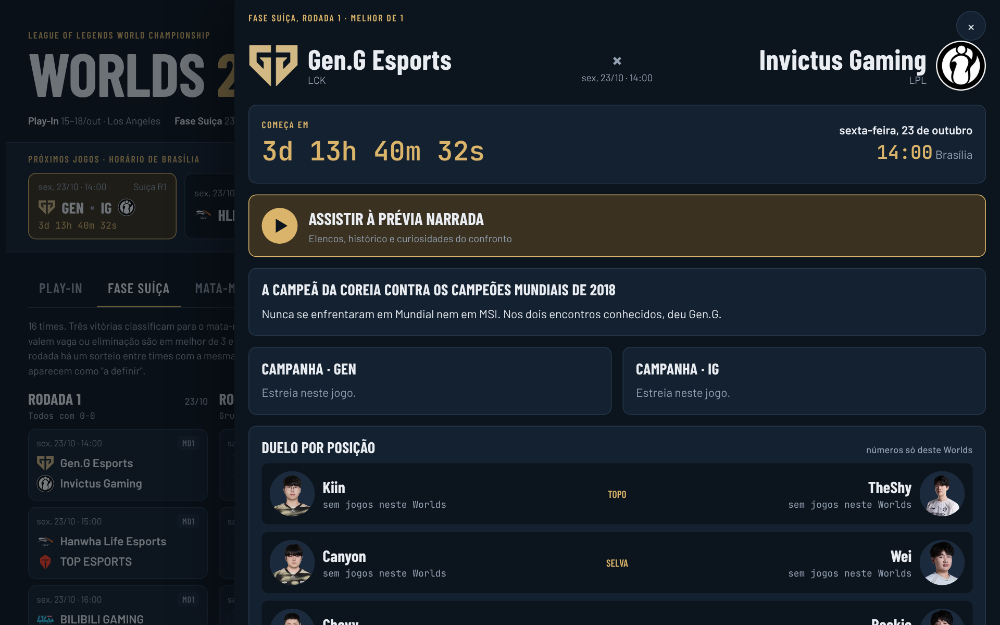

# Central do Worlds 2026

Site com as chaves, estatísticas e replays do Mundial de League of Legends 2026, em português e no horário de Brasília.

Site: https://gabriel00lima.github.io/worlds-2026-analytics/



## Sobre

Comecei esse projeto porque queria acompanhar o Worlds num lugar só: ver a chave, abrir um confronto e entender o que aconteceu no jogo sem precisar rever a transmissão inteira.

Um script em Python busca os dados na API do LoL Esports, processa a linha do tempo de cada partida e gera uma página estática com tudo embutido. Clicando num confronto dá para ver a prévia, os números de cada jogador e um replay animado com os principais lances narrados.



## Como funciona

O `site-worlds/coletar.py` baixa a agenda, os times, os elencos e o estado de cada jogo, que o feed da Riot entrega de 10 em 10 segundos. Como o feed não diz o que aconteceu, os abates, torres e dragões são encontrados comparando um quadro com o seguinte. Os downloads rodam em paralelo e ficam em cache, então só o que é novo é baixado de novo.

O `site-worlds/extras.py` complementa com bans da Leaguepedia e, se houver uma `RIOT_API_KEY` no ambiente, com as partidas de solo queue dos jogadores.

O site é HTML, CSS e JavaScript sem framework. Os dados entram no `modelo.html` e saem num único `index.html`, publicado pelo GitHub Pages a partir da pasta `docs/`.



## Rodando

```bash
pip install -r requirements.txt
python curiosidades/gerar.py
python site-worlds/coletar.py
```

O site gerado fica em `site-worlds/index.html`. Para os testes, `pip install pytest` e `pytest`.

## Limitações

O feed não manda a posição dos jogadores, então no replay eles aparecem na rota em que jogam, não no ponto exato do mapa. As contas de solo queue vêm da Leaguepedia, que é mantida pela comunidade e às vezes está desatualizada.

---

Projeto pessoal, sem ligação com a Riot Games. Licença MIT.
