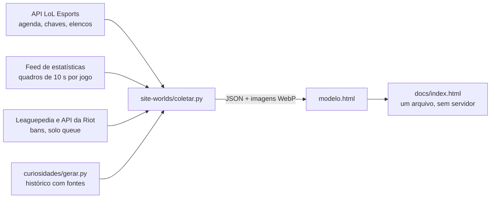

# Central do Worlds 2026

**🇧🇷 Português** · [🇺🇸 English](README.en.md)

[](https://github.com/gabriel00lima/worlds-2026-analytics/actions/workflows/ci.yml)


Acompanho o Mundial de League of Legends todo ano e sempre senti falta de um lugar que juntasse, em português e no horário de Brasília, a chave do torneio, os números de cada jogo e um jeito rápido de entender o que aconteceu numa partida sem assistir horas de transmissão. Então construí um.

O projeto coleta os dados do **Worlds 2026** direto das APIs públicas do LoL Esports, trata tudo em Python e gera um site estático com chaves clicáveis, prévias dos confrontos, estatísticas de times e jogadores e um **replay animado e narrado** de cada partida.

**[▶ Ver o site no ar](https://gabriel00lima.github.io/worlds-2026-analytics/)**


## Funcionalidades

- **Chaves do torneio:** Play-In em dupla eliminação, Fase Suíça com 5 rodadas e mata-mata. Cada confronto abre uma página própria.
- **Prévia do confronto:** contagem regressiva, campanha de cada time, duelo por posição com foto dos jogadores, histórico entre os times e curiosidades. Cada curiosidade guarda a fonte e um nível de confiança.
- **Replay narrado:** a partida é reconstruída no mapa a partir de amostras de 10 em 10 segundos, com abates, torres, dragões, Barão, gráfico de diferença de ouro e narração por voz.
- **Jogadores:** KDA, ouro, farm e campeões de cada jogador no torneio, além do que ele anda jogando na solo queue.
- **Rankings do torneio:** quem mais abateu e os campeões mais escolhidos e mais banidos.
- **Palpites:** o visitante escolhe quem vence e o placar.
- Funciona bem no celular.

<p>
  
  
</p>

## Como funciona



**Coleta.** O `coletar.py` pagina a agenda da liga, cruza os times com os elencos e baixa a linha do tempo de cada jogo em lotes paralelos com `ThreadPoolExecutor`. Tudo vai para um cache em disco, então rodar de novo só busca o que é novo. As requisições têm retentativa com espera crescente, porque o feed oscila bastante em dia de jogo.

**Tratamento.** O feed entrega o estado do jogo a cada 10 segundos, mas não diz o que aconteceu. Os eventos (abate, torre, dragão, Barão) saem da comparação entre dois quadros seguidos. O relógio de jogo desconta as pausas técnicas, a série temporal é reduzida a um ponto a cada 30 segundos para o site ficar leve e o vencedor de cada jogo é deduzido do estado final e conferido com o placar oficial da série.

**Site.** HTML, CSS e JavaScript puros, sem framework e sem etapa de build. Os dados e as imagens (convertidas para WebP com Pillow) entram embutidos num único `index.html`, que abre direto do disco ou em qualquer hospedagem estática, como o GitHub Pages. O mapa e os gráficos são SVG e a narração usa a Web Speech API do navegador.

**Atualização.** Durante o torneio um agendamento roda o coletor duas vezes por dia e publica a versão nova.

## Estrutura

```
site-worlds/     coleta (coletar.py, extras.py) e o template do site (modelo.html)
curiosidades/    histórico e curiosidades de cada confronto e time, em JSON
soloq/           contas de solo queue dos 81 jogadores e os scripts que as coletam
resumo-diario/   resumo em Markdown dos jogos de um dia
tests/           testes com pytest
docs/            site publicado (GitHub Pages) e imagens deste README
```

## Rodando localmente

Precisa de Python 3.10 ou mais novo.

```bash
git clone https://github.com/gabriel00lima/worlds-2026-analytics.git
cd worlds-2026-analytics
pip install -r requirements.txt

python3 curiosidades/gerar.py              # gera os JSON de curiosidades
python3 site-worlds/coletar.py             # coleta os dados e gera site-worlds/index.html
python3 site-worlds/coletar.py --so-site   # só regera o HTML a partir do cache

python3 resumo-diario/resumo.py 2026-10-18 # resumo dos jogos de um dia
```

Depois é só abrir `site-worlds/index.html` no navegador.

Nenhuma chave é obrigatória. A API do LoL Esports usa uma chave pública, a mesma que o lolesports.com manda do navegador, e ela pode ser trocada pela variável `LOLESPORTS_API_KEY`. Para trazer as partidas de solo queue, defina `RIOT_API_KEY` com uma chave de desenvolvedor da Riot (veja `.env.example`).

### Testes

```bash
pip install -r requirements-dev.txt
pytest
```

O GitHub Actions roda os testes em Python 3.10 e 3.12 a cada push.

## Fontes de dados

| Fonte | O que vem dela |
|---|---|
| `esports-api.lolesports.com` | agenda, chaves, times, elencos e detalhes das séries |
| `feed.lolesports.com/livestats` | estado de cada jogo a cada 10 s: ouro, abates, torres, dragões, itens |
| Leaguepedia (`lol.fandom.com`) | bans, arautos e contas de solo queue dos jogadores |
| API da Riot | partidas recentes de solo queue |
| Data Dragon e `static.lolesports.com` | ícones de campeões e itens, logos e fotos |
| Sites de esports | histórico e curiosidades, com a URL de cada fonte |

## Limitações conhecidas

- O feed não traz coordenadas, então a posição dos jogadores no mapa do replay é aproximada pela rota de cada um.
- As contas de solo queue vêm de uma wiki mantida pela comunidade e podem estar desatualizadas.

## Próximos passos

- Placar ao vivo, buscando a API direto do navegador quando o site está no GitHub Pages.
- Comparar o desempenho dos times com Mundiais anteriores.

## Aviso

Projeto pessoal, sem fins comerciais. Não é endossado pela Riot Games. League of Legends e Riot Games são marcas registradas da Riot Games, Inc.

Feito por **Gabriel Lima** · código sob licença [MIT](LICENSE).
